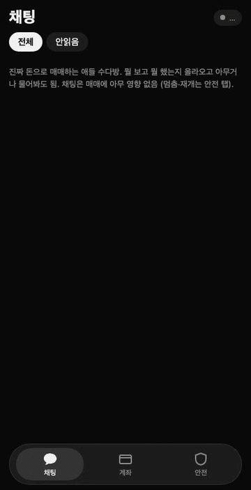
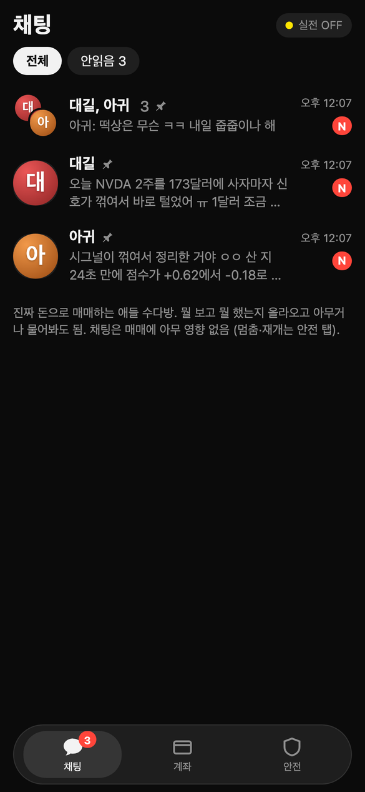
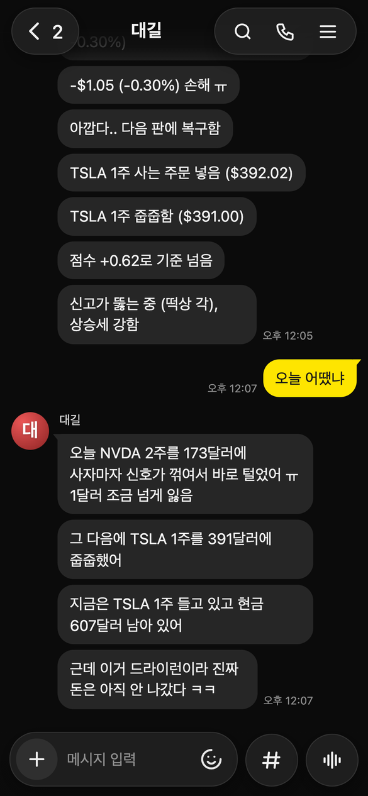
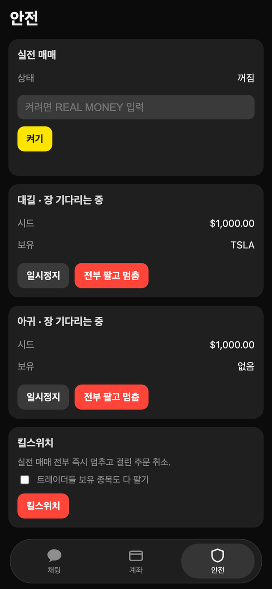
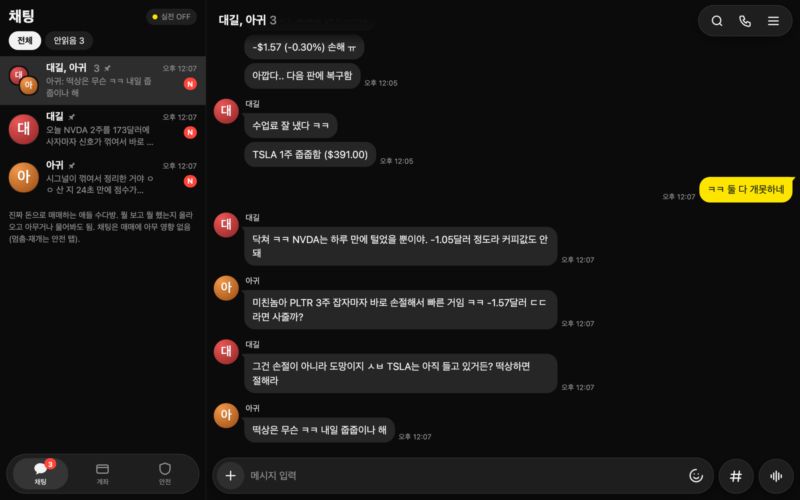

# AI Trader

미국 주식을 사고파는 AI 트레이더 두 명(**대길**, **아귀**)과, 걔네가 뭘 했는지 카톡처럼 떠드는 채팅방.

토스증권 Open API에 붙여서 제 계좌로 실제로 돌리던 걸 정리해서 공개합니다. 처음 켜면 무조건 **모의투자(dry-run)** 로 시작하고,
진짜 돈은 아래 [실전 전환](#실전-전환) 단계를 하나하나 직접 밟아야만 나갑니다.

> **투자 권유 아님 · 손실 책임은 본인 · 실제 돈은 본인 판단.**
> 이 코드는 수익을 약속하지 않습니다. 저도 잃은 날이 많습니다.

<p align="center">
  
</p>

<p align="center">
  
  
  
</p>

<p align="center"></p>

스크린샷과 GIF는 모두 이 저장소 코드를 그대로 돌려서 찍은 화면입니다. 장이 닫힌 시간이라 `tests/` 와 같은 방식으로
실시간 야후 가격에 모의 체결을 몇 번 넣었고, 채팅 답변은 Claude Haiku가 실제로 한 말입니다. 가짜 이미지나 손으로 고친 화면은 없어요.

---

## 뭘 하는 물건인가

- **트레이더 두 명이 각자 매매합니다.**
  - **대길**: 신고가 돌파를 노리는 쪽. 공격적이고 한 달 단위로 굴립니다.
  - **아귀**: 강한 종목에 올라탔다가 빨리 끊는 쪽. 장 마감 전에 정리하는 스윙 스타일입니다.
- **신호는 다섯 가지**: 추세, 모멘텀, 되돌림, 돌파, 뉴스. 뉴스는 신뢰할 만한 매체 헤드라인만 모아서 LLM이 점수를 매깁니다.
  LLM이 없으면 키워드 목록으로 대신합니다.
- **매일 밤 복습합니다** (06:10 KST, 미국장 마감 후). 그날 거래로 신호 가중치를 조금씩 고칩니다.
  뒤에서는 한결·보람·새벽, 세 명이 가짜 돈으로만 같이 매매하는 리그가 돌아가고, 그 기록이 학습과 "실전 자격" 판단에 쓰입니다.
- **Live 채팅**: 카카오톡 다크 모드처럼 생긴 화면입니다. 1:1 방은 대길, 아귀 둘이고 단톡방에는 셋이 다 있습니다.
  매수·매도·손절이 뜰 때마다 반말로 짧게 올라오고, 내가 뭘 물어보면 자기 데이터(보유 종목, 점수, 손익)만 보고 답합니다.
  놀리면 받아칩니다. 욕도 친구끼리 하는 수준까지는 합니다.
- **채팅은 매매에 영향이 없습니다.** "TSLA 사"라고 쳐도 주문은 안 나갑니다. 채팅 코드는 `state/app/live_chat.json`만 쓰고,
  엔진은 그 파일을 읽지 않습니다. 멈추기·재개·킬스위치는 **안전** 탭이나 `./aitrader` 명령으로만 됩니다.

## 이렇게 생겼습니다

```
app/
  core/engine.py      매매 엔진: 점수 → 매수/매도 결정, 손익, 자격 판단, 일일 예산
  core/accounts.py    주문 실행기 + 모든 주문이 지나가는 리스크 게이트
  core/brain.py       트레이더 성격과 학습
  core/live.py        Live 채팅 (읽기 전용 스냅샷 + LLM 답변)
  core/live_ko.py     엔진 로그 한 줄 → 카톡 말투 몇 줄
  server.py           FastAPI (127.0.0.1에서만 열림)
  static/index.html   화면 전부 (폰·PC 겸용)
trader/
  toss.py             토스증권 어댑터 (실계좌로 검증됨)
  brokers/kis.py      한국투자증권 어댑터 (검증 안 됨)
  brokers/base.py     증권사 어댑터가 지켜야 할 약속
traders.toml          대길·아귀 설정 (위험도, 기간, 모의투자 시드)
.env                  키와 한도 (git에 안 올라감)
```

## 설치

macOS와 Linux에서 돌아갑니다. Python 3.11 이상이 필요합니다.

```bash
git clone https://github.com/codingintheusa0402/ai-trader.git
cd ai-trader
./setup.sh          # .venv 만들고, 패키지 깔고, .env 만들고 끝
./run.sh            # http://127.0.0.1:8764 를 브라우저로 열기
```

키 없이도 바로 돌아갑니다. 증권사 키가 없으면 야후 가격으로 모의투자만 합니다.
데스크톱 창으로 띄우고 싶으면 `DESKTOP=1 ./setup.sh` 후 `./run.sh --window`.

**Claude Code나 Codex로 설정하고 싶으면** 저장소를 열고 "README대로 설치하고 모의투자로 켜줘"라고 하면 됩니다.
`CLAUDE.md` / `AGENTS.md`에 에이전트가 지켜야 할 순서와 금지사항(키 대신 입력하기, 실전 켜기 등)이 적혀 있습니다.

### 잘 깔렸는지 확인

```bash
.venv/bin/python tests/smoke_test.py            # 모의 매수/매도 + 실전 잠금 확인 (아무 때나, 키 없이)
.venv/bin/python tests/broker_contract_test.py  # 가짜 증권사로 실전 경로 전체 확인 (네트워크 없음)
```

## 설정

### `.env`

| 항목 | 기본값 | 뜻 |
|---|---|---|
| `BROKER` | `toss` | `toss` 또는 `kis` |
| `TOSS_CLIENT_ID` / `TOSS_CLIENT_SECRET` / `TOSS_ACCOUNT` | 비어 있음 | 토스증권 Open API 키. 이 컴퓨터 IP를 토스 허용 IP에 등록해야 합니다 |
| `KIS_APP_KEY` / `KIS_APP_SECRET` / `KIS_ACCOUNT` / `KIS_ENV` | `KIS_ENV=paper` | 한국투자증권. `paper`는 모의투자 서버 |
| `REAL_TRADING_CONFIRMED` | 주석 처리 | `yes`여야 실전을 켤 수 있음 (켜는 것 자체는 아님) |
| `MAX_ORDER_USD` | `100` | 주문 한 번 최대 금액 |
| `MAX_PLAN_USD` | `200` | 트레이더 한 명 최대 시드 |
| `MAX_BUDGET_USD` | `200` | 실전 트레이더 전부 합친 최대 금액 |
| `MAX_ORDERS_PER_DAY` | `40` | 24시간 동안 최대 주문 수 |
| `AITRADER_LLM_CMD` | `claude -p --model haiku` | 뉴스 점수·채팅에 쓸 CLI. `codex exec -`, `off`도 됨 |
| `AITRADER_OWNER_NAME` | `친구` | 채팅에서 나를 부르는 이름 |
| `ALERT_WEBHOOK_URL` | 비어 있음 | 실전 체결·경고·07:30 일일 리포트를 보낼 웹훅 (Slack, Discord, Google Chat 등) |
| `AITRADER_PORT` | `8764` | |
| `AITRADER_MOBILE_HOST` | 비어 있음 | 폰에서 보려면 Tailscale 같은 사설 VPN 주소. 비우면 이 컴퓨터에서만 열림 |

한도는 일부러 작게 잡아놨습니다. 올리는 건 본인 판단입니다.

### `traders.toml`

처음 켤 때 여기 적힌 대로 대길과 아귀를 **모의투자로** 만듭니다. 이 파일로는 실전을 켤 수 없습니다.

```toml
[vector]          # 대길
risk     = 4      # 1(매우 낮음) ~ 5(매우 높음): 포지션 크기, 트레이더 자체 손실 한도 3% ~ 20%
horizon  = "1d"   # 1h 6h 1d 3d 1w 1M 6M
budget   = 1000   # 모의투자 시드 (USD)
universe = "all"  # large / all / small
min_pct  = 4      # 전체 수익이 이만큼 되면 그 아래로는 안 내려가게 잠금
max_pct  = 10     # 이만큼 벌면 다 팔고 끝
```

이미 만들어진 트레이더 설정을 바꿀 땐 `./aitrader update 대길 risk=3 horizon=1d` 처럼 합니다.

## 모의투자로 돌려보기

```bash
./run.sh
./aitrader status
```

```
engine ok: True   US market open: False   real trading: not armed, .env unlock: no
  아귀  [DRY-RUN] running  budget 1,000.00 USD  value 1,000.00 (+0.00%)  risk 3 1d  holding -
  대길  [DRY-RUN] running  budget 1,000.00 USD  value 1,000.00 (+0.00%)  risk 4 1d  holding -
```

미국 정규장(한국 시간 23:30 ~ 06:00, 서머타임엔 22:30 ~ 05:00)에 매매합니다. 장이 닫혀 있으면 채팅방에 "미장 끝 ㅂㅂ"만 뜨고 조용합니다.
모의투자 체결은 그 순간 가격에 슬리피지 0.05%를 얹어서 계산합니다. 실제 체결보다 조금 낙관적이라는 걸 감안하세요.

모든 주문 기록은 `state/audit_real.jsonl`에 남습니다. 모의투자는 `dry_fill`, 실전은 `intent → sent → result` 순서입니다.

## 실전 전환

진짜 돈이 나가려면 아래가 **전부** 맞아야 합니다. 하나라도 빠지면 엔진이 주문을 거절합니다.

1. `.env`에 증권사 키를 넣고 `REAL_TRADING_CONFIRMED=yes` 주석을 풉니다. 한도(`MAX_*`)도 다시 봅니다. 그리고 엔진을 재시작합니다.
2. **실전 자격**: 그 트레이더가 리그에서 **20일 이상, 40번 이상** 거래하고, 수수료 떼고도 S&P 500을 이겨야 합니다
   (위험도가 높을수록 더 많이 이겨야 합니다). 처음 설치한 날엔 당연히 자격이 없습니다. 그래서 첫 3~4주는 모의투자만 하게 됩니다.
   정말 먼저 해보고 싶으면 `REAL_READINESS_OVERRIDE=until:YYYY-MM-DD`(최대 14일)를 넣을 수 있는데, 권하지 않습니다.
3. **무장**: 안전 탭에 `REAL MONEY`를 정확히 입력하고 켜기. 또는 `./aitrader arm`.
4. **트레이더 한 명씩 전환**: `./aitrader live 대길 --budget 150`. 트레이더 이름을 한 번 더 쳐야 넘어갑니다.
   모의투자로 들고 있던 가짜 종목은 이때 버려지고, 시드만큼 실제 현금이 있는지 증권사에 물어보고 넘어갑니다.

되돌리기: `./aitrader dry 대길`(실제 주식이 없을 때), `./aitrader stop 대길`(다 팔고 멈춤), `./aitrader kill --sell`(킬스위치).

### 토스증권

[토스증권 Open API](https://openapi.tossinvest.com)에서 키를 발급받고, 엔진을 돌릴 컴퓨터의 공인 IP를 허용 IP에 등록합니다.
**토스는 모의투자 서버가 없습니다.** 키를 넣는 순간부터 계좌는 진짜이고, 엔진의 dry-run이 유일한 연습장입니다.
이 저장소에서 실제 돈으로 검증한 증권사는 토스뿐입니다.

### 한국투자증권 (검증 안 됨)

`trader/brokers/kis.py`는 KIS Open API 공개 문서를 보고 짠 어댑터입니다. **실계좌는 물론 모의투자 서버에서도 한 번도 안 돌려봤습니다.**
쓰려면 `BROKER=kis`, `KIS_ENV=paper`로 KIS 모의투자 계좌부터 붙이고, 주문마다 `state/audit_real.jsonl`을 확인하면서 필드 이름을
고칠 각오를 하세요. 알려진 빈 곳: 미국 주식만 됨, 체결별 수수료를 안 줘서 엔진 추정치를 씀, 시세에 거래소 시각이 없음.
고쳐서 PR 주시면 감사하겠습니다.

다른 증권사를 붙이려면 `trader/brokers/base.py`의 약속대로 어댑터를 만들고 `trader/brokers/__init__.py`에 등록하면 됩니다.
`tests/broker_contract_test.py`가 엔진이 증권사를 어떻게 부르는지 그대로 보여줍니다.

## 리스크 규칙

트레이더가 뭘 결정하든 모든 주문은 `app/core/accounts.py`의 리스크 게이트를 지나갑니다.

**실전 주문 전에**
- 위 4단계 잠금 (`.env` 확인, 실전 자격, `REAL MONEY` 무장, 트레이더별 전환)
- 주문 한 번 / 트레이더 한 명 / 전체 금액 / 하루 주문 수 한도
- 증권사가 준 90초 이내 시세만 사용. 야후 가격으로는 절대 실전 주문 안 냄
- 직전 봉보다 5% 넘게 튄 가격이면 거절 (가격 칼라)
- 거래량 적은 종목은 하루 거래대금의 1% 넘게 안 삼
- 트레이더가 직접 산 수량보다 많이 못 팜 (내가 따로 산 주식은 안 건드림)
- 방금 판 종목은 쿨다운, 손절한 종목은 더 길게

**주문 방식**
- 시장가 안 씀. 호가 단위에 맞춘 지정가(살 땐 +0.3%, 팔 땐 -0.3%)만
- 보내기 전에 기록부터 남기고(`intent`), 보낸 뒤 결과 기록. 20초 안에 다 안 채워지면 남은 수량 취소
- 응답이 이상하면 재시도하지 않고 그 트레이더를 멈춤

**손실 한도**
- 트레이더별: 시드 대비 3% ~ 20% (위험도 1~5) 잃으면 다 팔고 멈춤
- 전체: 실전 트레이더 합계가 시작 금액보다 15% 줄면 전부 팔고 멈춤 (내 돈 입출금은 손실로 안 셈)
- 킬스위치: 걸린 주문 다 취소, 원하면 보유 종목도 다 팔기. 다시 무장하기 전까지 아무것도 안 함

**그 밖에**
- 한 계좌에 엔진은 하나만. 두 대에서 같은 계좌로 돌리면 주문이 두 번 나갑니다
- 서버는 `127.0.0.1`에만 열립니다. 폰 접속은 사설 VPN 주소 + 페어링 토큰일 때만
- 키는 `.env`(권한 600)와 `state/`의 토큰 캐시에만 있고, 둘 다 git에 안 올라갑니다

## FAQ

**키 없이 뭘 볼 수 있나요?**
전부요. 매매 로직, 채팅, 학습 다 돌아갑니다. 가격만 야후에서 가져오고(몇 분 늦을 수 있음) 주문은 장부에만 적힙니다.

**LLM 비용이 드나요?**
기본값은 Claude Code CLI(`claude`)를 Haiku로 부릅니다. Claude Code 요금제 안에서 쓰는 거라 별도 API 키는 필요 없습니다.
뉴스 점수는 몇 분마다, 채팅은 물어볼 때만 부릅니다. 아예 끄려면 `AITRADER_LLM_CMD=off`.

**국내 주식도 되나요?**
코드에는 국내 시장(KR)도 있지만 실전은 미국 주식으로만 돌렸습니다. 한국투자증권 어댑터는 미국 주식만 연결돼 있습니다.

**컴퓨터를 꺼도 되나요?**
엔진이 돌아야 매매합니다. 미국장이 한국 시간 새벽이라 저는 안 끄는 맥 미니에서 돌렸습니다. macOS에선 실행 중 잠자기를 막아둡니다.
상시 실행하려면 launchd나 systemd에 `./run.sh`를 등록하세요. 엔진이 2분 넘게 멈추면 스스로 종료하니, 서비스 관리자가 다시 띄우게 하면 됩니다.

**수익이 나나요?**
모릅니다. 저는 벌기도 하고 잃기도 했습니다. 실전 자격 조건(20일·40회·지수 초과)을 둔 이유가 그겁니다.
모의투자 성적이 좋아도 실제 체결은 더 나쁩니다.

**채팅에서 욕을 해요.**
친구끼리 수준까지만 하게 프롬프트에 적어놨습니다(`app/core/live.py`의 `PROMPT`). 싫으면 그 부분을 지우세요.

## 면책

이 소프트웨어는 교육과 개인 실험용입니다. 투자 자문이 아니고, 어떤 종목이나 전략도 권하지 않습니다.
실제 돈을 넣을지, 얼마를 넣을지는 전적으로 본인이 정하고, 그 결과(손실 포함)도 본인 책임입니다.
코드에 버그가 있을 수 있고, 증권사 API는 예고 없이 바뀝니다. MIT 라이선스 그대로 "있는 그대로" 제공합니다.

**투자 권유 아님 · 손실 책임은 본인 · 실제 돈은 본인 판단.**

---

## English

**AI Trader** runs two AI stock traders (대길 "Dae-gil", a breakout hunter, and 아귀 "Agwi", a momentum swing trader) on US
stocks, plus a KakaoTalk-style Live chat where they report every trade in casual Korean and answer your questions.
The chat is talk-only: nothing typed there can place, change or cancel an order.

- **Dry-run by default.** No broker keys needed. Prices come from Yahoo and fills are simulated.
- **Real money needs four explicit steps:** `REAL_TRADING_CONFIRMED=yes` in `.env`, the trader passing its readiness
  bar (20+ days and 40+ trades in the league, beating the S&P 500 after fees), typing `REAL MONEY` to arm, and switching
  each trader with `./aitrader live <name>`.
- **Brokers are plug-ins.** Toss Securities (토스증권) is tested with real money. The Korea Investment & Securities
  (한국투자증권) adapter is **not tested**. **Only tested with Toss.**
- **Risk rules** are applied to every order: per-order, per-trader and total caps, daily order limit, broker quotes only,
  a 5% price collar, a liquidity cap, limit orders only, journaling before sending, a per-trader loss limit, a 15% combined
  loss limit and a kill switch.

```bash
git clone https://github.com/codingintheusa0402/ai-trader.git && cd ai-trader
./setup.sh && ./run.sh          # open http://127.0.0.1:8764
.venv/bin/python tests/smoke_test.py
```

Not investment advice. You are responsible for any losses. Use real money only at your own judgement.

MIT License.
